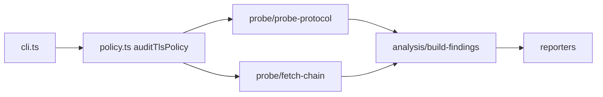

# hx-tls-policy-cli — architecture

## Purpose

Opens TLS connections to a target host/port, negotiates individual protocol versions,
collects certificate chains, and derives policy findings (weak protocols, cert expiry,
chain issues). Non-goals: mutual TLS client auth testing or STARTTLS SMTP.

## High-level flow

## Module map

| Path                                 | Responsibility                           |
| ------------------------------------ | ---------------------------------------- |
| `src/cli.ts`                         | Commander `audit`, port flag, exit codes |
| `src/policy.ts`                      | Public audit orchestration               |
| `src/core/audit-tls-policy.ts`       | Wire probes + chain into report          |
| `src/probe/probe-protocol.ts`        | Version-specific handshake attempt       |
| `src/probe/fetch-chain.ts`           | Peer certificate chain extraction        |
| `src/constants/protocols.ts`         | Supported protocol ordered list          |
| `src/analysis/build-findings.ts`     | Rules from probe + cert data             |
| `src/analysis/summarize-findings.ts` | High-severity gate for exit `2`          |
| `src/reporters/`                     | JSON and table formatters                |

## Extension

1. Add a protocol constant and probe branch in `probe-protocol.ts`.
2. Extend `build-findings.ts` with a new rule and unit test using mocked sockets.
3. Keep live TLS in `tests/tls.integration.test.ts` only.
4. Run `npm test` and `npm run format:check`.

## Testing strategy

- **Unit**: findings builder, protocol constants, reporters (`*.spec.ts`) with mocks.
- **Integration**: `tests/tls.integration.test.ts` against documented public endpoints.

## Ethics & scope

Authorized engagements only. See [SECURITY.md](./SECURITY.md).
